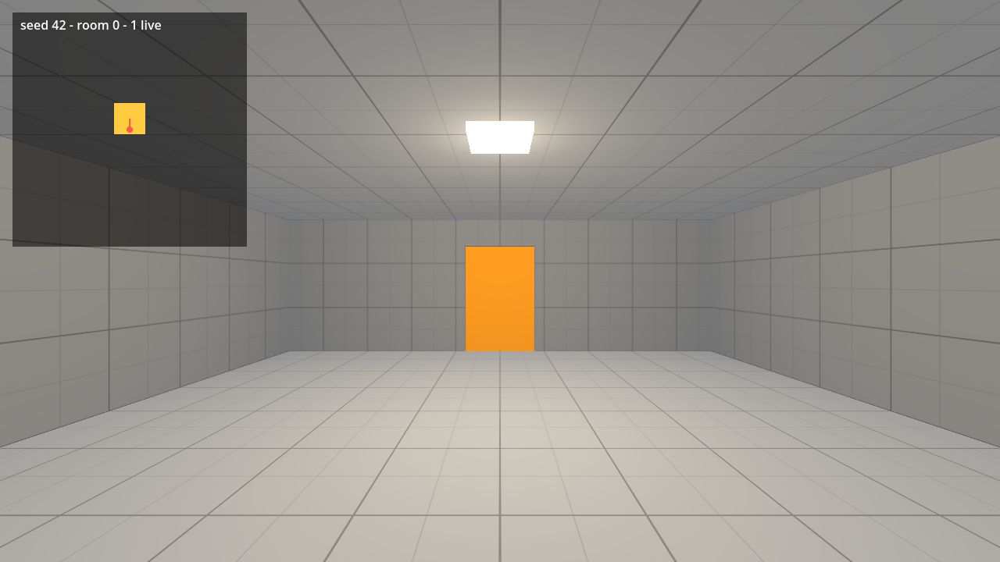

# Rooms and Doors in Godot 4

Project files for tutorial 01 of the Godot 4 series by Phaix on YouTube (https://www.youtube.com/@Phaix).

Build an endless chain of rooms in Godot 4, in nine small steps. Doors open as you walk up, the next room snaps onto the exit and is tested for overlap, rooms behind you disappear, and a seed makes every run reproducible. Graybox only, no art needed, every step is its own project folder.



## Steps

Every step of the video is its own folder in `steps/`, the exact state at the end of that
part. Open the project in Godot 4.7, then open `steps/<step>/main.tscn` and press F6 to run
that step. The project's main scene is the final step.

| Folder | Part of the video |
|---|---|
| `steps/step_01_one_room` | Step 1 - One room |
| `steps/step_02_snap_rooms` | Step 2 - Snap rooms together |
| `steps/step_03_seeded_types` | Step 3 - Room types and a seed |
| `steps/step_04_overlap_check` | Step 4 - Test before you place |
| `steps/step_05_walking_player` | Step 5 - A player that walks |
| `steps/step_06_mouse_look` | Step 6 - Mouse look |
| `steps/step_07_door` | Step 7 - A door that opens |
| `steps/step_08_on_the_fly` | Step 8 - Rooms on the fly |
| `steps/step_09_debug_map` | Step 9 - Debug map |

## Controls

WASD or arrow keys or the left stick to walk, mouse or right stick to look, Space to jump,
Esc gives the mouse back, a click captures it again. Further keys per tutorial are shown
in the video and in the HUD.

## Tests

```sh
godot --headless --path . -s res://tests/run_tests.gd
```

## License

Code and scenes: MIT (see LICENSE).
